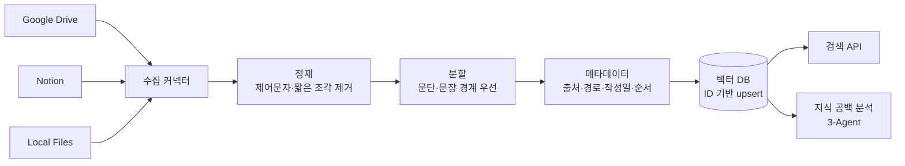
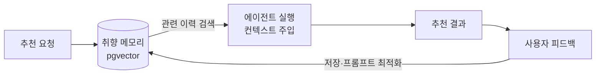
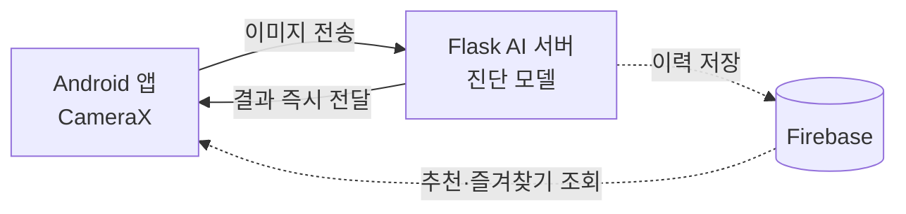
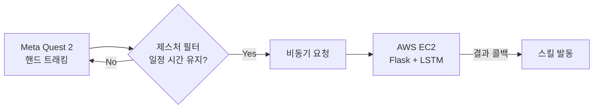
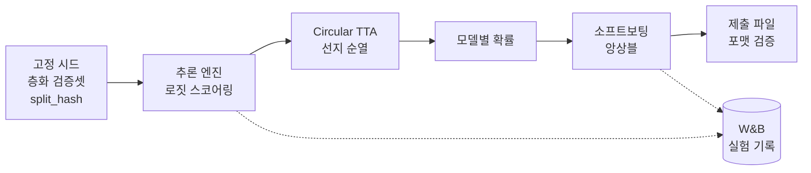
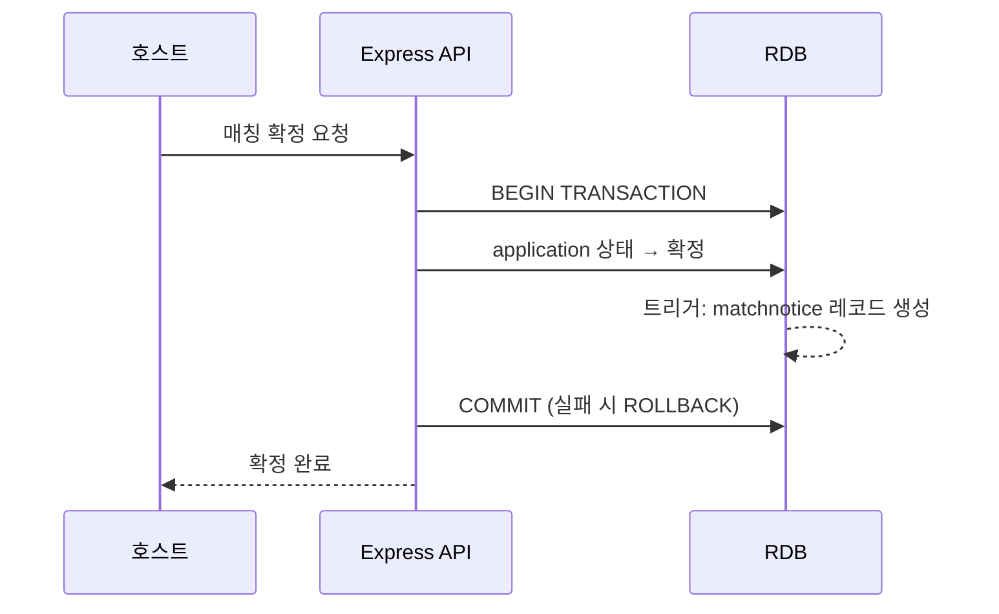

# 이시현 · Shihyun Lee

### AI Data · Backend Engineer

**흩어진 데이터를 모으고, 정제하고, AI가 믿고 쓸 수 있는 지식으로 만듭니다.**

---

## 👋 About

- **데이터 파이프라인** — Drive·Notion·로컬·웹 등 출처가 다른 데이터를 수집해 정제·분할·메타데이터를 붙여 적재합니다.
- **AI가 쓰는 지식 설계** — 벡터 DB 기반 RAG, 실행 전 컨텍스트 주입, 도구를 호출하는 멀티 에이전트 구조를 만들어 왔습니다.
- **정합성과 안정성** — 트랜잭션·트리거, 식별자 기반 연결, 단위 예외 격리로 "한 건의 실패가 전체를 멈추지 않는" 구조를 지향합니다.
- **근거로 판단** — 추측보다 로그와 데이터로 원인을 좁히고, 같은 문제가 반복되지 않도록 구조를 바꿉니다.

 

## 🛠 Tech Stack

| 분야 | 기술 |
|:---:|:---|
| **Language** |       |
| **Backend** |     |
| **Data · AI** |      |
| **Infra** |     |
| **Client** |    |

 

## 📌 Projects at a Glance

| # | 프로젝트 | 핵심 키워드 | 역할 |
|:---:|:---|:---|:---|
| 1 | **개인 지식 검색 서비스** | 문서 수집·정제·분할·벡터 적재, 멀티 에이전트 | 수집·검색 파이프라인 |
| 2 | **LLM 에이전트 개인화 추천** | RAG 메모리, 피드백 학습 루프, K8s 배포 | RAG·피드백 파이프라인 |
| 3 | **퍼스널 컬러 AI 진단·추천** | 인터페이스 설계, 서버 추론, 데이터 수집 | 3인 팀장 |
| 4 | **수어 인식 VR 게임** 🏆 | AI 서버 실시간 연동, 비동기 구조 | AI–게임 연동 |
| 5 | **한국어 이미지 VQA 챌린지** | 학습·추론·앙상블 자동화, 로짓 스코어링 | 인프라·파이프라인 |
| 6 | **교내 매칭 웹앱** | 트랜잭션, SQL 트리거, API 스펙 | 백엔드 |
| 7 | **인터랙티브 게임 10종 (인턴)** | 공통 프레임워크, 운영 안정화 | 기획·개발·배포 |

 

---

## 1. 개인 지식 검색 서비스
> Google Drive · Notion · 로컬 문서를 수집해 의미 기반으로 검색하는 지식 검색 서비스

`3인 팀` `FastAPI` `ChromaDB` `ko-sroberta` `LangChain` `Docker Compose` · [Repository](https://github.com/chaerinotcherry/personal-search-agent)

**담당** 수집 커넥터 · 문서 정제/분할/임베딩 · 검색 API · 지식 공백 분석

<b>설계 포인트 자세히 보기</b>

 

| 구분 | 내용 |
|---|---|
| **분할** | 문단 → 문장 → 공백 순으로 경계를 우선하는 재귀 분할, 512자 · 64자 오버랩 |
| **정제** | 제어문자·null 문자 제거, 의미 없는 10자 이하 조각 제외, 입력 길이 상한 |
| **중복 방지** | `문서 식별자 해시 + 조각 순서`로 ID를 만들어 재수집 시 덮어쓰기(upsert) |
| **확장성** | 저장 방식을 환경 변수로 전환하는 커넥터 팩토리 구조로 로컬 → 클라우드 전환 대비 |
| **지식 공백 분석** | 단순 군집화 방식을 역할을 나눈 3개 에이전트가 도구를 호출하며 협력하는 구조로 재설계, 목표 기반 학습 로드맵, LLM API 호출 제한 처리 |
| **배운 점** | 출처마다 작성일 형식이 달라 정렬이 어긋나는 문제를 겪으며, 메타데이터는 **수집 시점에 표준화**해야 한다는 기준을 세움 |

---

## 2. LLM 에이전트 기반 개인화 추천 서비스
> 쓸수록 사용자에게 맞춰지는 멀티 에이전트 라이프스타일 추천 서비스

`3인 팀` `8주` `pgvector` `LangGraph` `DSPy` `React PWA` `Kubernetes`

**문제** 에이전트가 실행할 때마다 사용자를 처음 보는 것처럼 동작해 추천이 개인화되지 않음

- 사용자 취향 이력을 벡터 DB에 저장하고 **에이전트 실행 직전 검색해 주입하는 RAG 메모리** 설계
- 피드백 수집 화면 → 저장 → 프롬프트 최적화 반영까지 **학습 루프** 구현
- 히스토리 뷰와 PWA 클라이언트 구현, Kubernetes 환경에 배포

---

## 3. 퍼스널 컬러 AI 진단 · 화장품 추천 서비스
> 얼굴 사진으로 퍼스널 컬러를 진단하고 맞춤 색조 화장품을 추천하는 Android 서비스

`룰루랩 산학협력` `3인 팀장` `2024.04–12` `Kotlin` `Flask` `PyTorch` `Firebase`

| 결정 / 문제 | 해결 | 결과 |
|---|---|---|
| 모델을 어디서 실행할까 | 발열·모델 교체 비용을 고려해 단말 대신 **서버 추론** 선택 | 앱 재배포 없이 모델 개선 |
| 피부톤 신호 왜곡 | 색조·채도 변환 증강을 빼고 **색상 보존 증강만** 사용 | 정확도 **83% → 88.7%** |
| 결과 화면 0.5초 지연 | 저장 후 재조회 왕복을 찾아 **전달과 저장 경로 분리** | 지연 제거 |
| 경계선 사용자 신뢰 문제 | 응답 형식을 **상위 2개 결과 + 확률**로 먼저 정하고 파트별 반영 | 기업 요구 반영 |
| 추천 데이터 수집 실패 | 옵션명 대신 **상품 코드+옵션 코드 복합 식별자**, 상품 단위 예외 격리 | 옵션 765개·리뷰 수집 |

---

## 4. 수어 인식 VR 게임 — Magic & Merge 🏆
> 수어 동작을 콤보로 조합해 마법을 발동하는 핸드 트래킹 VR 게임

`2024 메타버스 개발자 경진대회 Meta상(장려상)` `Unity` `C#` `Flask` `AWS EC2` `LSTM` · [Repository](https://github.com/sighen/MetaConte)

- **문제** 스킬 발동 지연과 화면 끊김 → 팀은 모델 정확도를 의심해 재학습했지만 해결되지 않음
- **원인** 서버 응답 로그와 게임 루프 프레임 타이밍을 비교해 **동기 블로킹**을 찾아냄
- **해결** 요청·응답 대기를 렌더링과 비동기로 분리, 매 프레임 호출을 **제스처 유지 시에만 호출**하도록 필터링 → 끊김 제거, 서버 부하·오인식 감소
- 개발 전 MVP로 사용자 설문·인터뷰를 진행해 튜토리얼·가이드 UI로 기획 보완

---

## 5. 한국어 이미지 기반 VQA 챌린지
> 이미지·질문·4개 선택지에서 정답을 고르는 객관식 VQA. **API 없이 로컬 오픈웨이트 모델만** 사용 가능

`SSAFY` `4인 팀` `3일` `Qwen2.5-VL` `Qwen3-VL` `Gemma` `LoRA SFT` `W&B` `RTX 5060 Ti 16GB`

**담당** 팀의 크리티컬 패스인 **인프라·추론 파이프라인 트랙** — 검증 체계, 추론 엔진, TTA, 앙상블, 제출 자동화, 실험 규약

<b>내가 만든 것 자세히 보기</b>

 

| 구성 요소 | 내용 |
|---|---|
| **환경 세팅** | Blackwell(sm_120) GPU에서 기본 PyTorch가 동작하지 않는 문제를 cu128 빌드로 해결, 4명이 같은 환경을 바로 검증하도록 스모크 테스트 스크립트 작성 |
| **검증 체계** | 기존 검증셋 20개로는 1~2문항에 5%p가 흔들려 판단 불가 → **고정 시드 층화 분할 500개**를 레포에 고정하고 `split_hash`로 같은 검증셋인지 확인 |
| **평가** | 정확도와 함께 **선지별 예측 분포(a/b/c/d)** 를 기록해, 점수가 모델이 아닌 위치 편향에서 나오는지 감시 |
| **추론 엔진** | 생성 후 파싱하던 방식을 **a/b/c/d 토큰 로그확률을 바로 읽는 로짓 스코어링**으로 교체 → 파싱 실패 시 "a"로 찍히던 손실 제거, forward 1회로 단축 |
| **TTA** | 선지 순서를 돌려 여러 번 추론하고 확률을 평균하는 **Circular TTA**로 위치 편향 완화 (+2%p) |
| **앙상블** | 모델별 확률을 저장해 가중 소프트보팅, 기하평균·온도 보정 등 결합 방식 비교 |
| **제출** | 제출 포맷 검증을 포함한 제출 스크립트로 마지막 날 제출 사고 방지 |
| **실험 규약** | W&B 팀 프로젝트 하나로 통일, `담당_모델_해상도_기법` 이름 규칙과 필수 config(모델·해상도·프롬프트·시드·split_hash) 정의 → 4명 실험을 한 화면에서 비교 |

**팀 전략** — 우선순위를 난이도가 아닌 **"효과 ÷ 시간"** 으로 정하고, 결과를 합칠 수 있도록 **"한 사람은 한 축만 움직인다"** 는 규칙으로 역할을 나눔

| 단계 | 검증셋 정확도 |
|---|---|
| 베이스라인 (384px 고정) | 8B 기준 81.4% |
| 해상도 1280px | 95.4% |
| TTA 적용 | +2%p |
| 3개 모델 가중 앙상블 | 96.6% |
| **4개 모델 소프트보팅 (최종)** | **97.4%** |

**분석과 회고**
- **오답 분석:** 남은 오답의 30% 이상이 "글자는 읽었지만 이미지 속 여러 텍스트 중 엉뚱한 것을 고른" 경우(건물명 vs 입점 업체명, 메뉴판 인접 행 가격)였고, 해상도 부족은 약 20% → 다음 개선 방향을 텍스트 그라운딩으로 좁힘
- **통계적 검증:** 검증셋 500개는 ±2%p 해상도라 작은 개선은 판별 불가 → **McNemar 검정 기반 채택 기준**을 세워 감으로 기법을 채택하지 않도록 함
- **실패에서 배운 것:** 74문항에서 좋아 보이던 캐스케이드 TTA가 933문항에서는 효과 없음 → 실제 규모 재검증 원칙 / 약한 라벨(dev 다수결) 추가 시 성능 하락 → 노이즈 비율 측정 후 투입 기준
- **로컬–리더보드 격차:** 모델을 다양화할수록 2%p → 1.5%p로 감소

---

## 6. 교내 밥약 매칭 웹 애플리케이션 (스푼메이트)
> 학생들이 식사 약속을 열고 신청·매칭하는 교내 웹 서비스

`소프트웨어공학개론` `7인 팀` `2024.03–07` `React` `Node.js` `Express` `RDB` · [Organization](https://github.com/orgs/SKKU24-spoon-mate/repositories)

**담당** 사용자·매칭 페이지 백엔드, 마이페이지 별점·리뷰 UI와 리뷰 API 연동

| 문제 | 판단 | 해결 |
|---|---|---|
| 상태 변경과 알림 생성을 따로 처리하면 한쪽만 성공할 수 있음 | 신청이 몰리면 "매칭됐는데 알림 없음" 같은 불일치가 UX 문제로 이어짐 | 두 연산을 **하나의 트랜잭션**으로 묶어 함께 성공하거나 함께 실패 |
| 알림 전달 방식 | 폴링은 불필요한 요청이 많고 실시간성이 떨어짐 | 매칭 확정 시 `matchnotice` 레코드를 만드는 **트리거를 SQL로 직접 작성** |
| 연동 단계마다 응답 형식 충돌 반복 | 근본 원인은 API 스펙을 미리 합의하지 않은 것 | **구현 전 전체 API 스펙 확정 → SRS 문서화** 제안, 통합 단계 파싱 오류 크게 감소 |
| API 지연·오류 시 화면 깨짐 | 네트워크 상황은 통제할 수 없음 | 로딩 상태와 에러 처리 로직 설계 |

- 마이페이지 별점·리뷰 컴포넌트를 React 상태 관리로 구현해 입력이 즉시 반영되도록 구성

---

## 7. 대형 스크린 인터랙티브 게임 10종 — 에스엠메이커스 인턴
> 10주 안에 전시용 인터랙티브 게임 10종을 기획부터 배포까지

`2인 팀` `10주` `2024.12–2025.02` `Unity` `C#` `DOTween`

**담당** 게임 기획 · 개발 · 테스트 · 배포 전 과정

| 문제 | 해결 | 효과 |
|---|---|---|
| 10주에 10종 — 게임마다 공통 시스템을 새로 만들면 일정 불가 | 초반 1~2주를 **제네릭 싱글턴 + 공통 베이스 클래스** 설계에 투자 | 새 게임은 **상속만으로 추가**, 기존 코드 수정 없음 |
| 버튼 연타 시 게임 시작 코루틴 중복 실행 | `isGameRunning` **상태 플래그 기반 제어**, 공통 구조에 반영 | 모든 게임에 한 번에 적용 |
| 랜덤 배치 시 오브젝트 겹침 | 기존 오브젝트와 거리를 검사해 임계값 이내면 재생성 | 연산은 늘지만 전시 환경 가독성 우선 |
| UI 레이어가 게임 입력을 가로챔 | UI 이벤트와 게임 입력 판정 로직 분리 | 입력 충돌 해소 |
| 전시 장소마다 다른 스크린 크기 | Canvas Scaler·Anchor 최적화 | 해상도와 무관하게 동일 레이아웃 |

- **구현 기술:** Flood Fill 연결 탐색, 월드↔스크린↔로컬 좌표 변환, Raycast 입력 처리, 코루틴 비동기 흐름 제어, 이벤트 델리게이트로 컴포넌트 결합도 최소화, DOTween 애니메이션
- **결과:** 10종 전부 기한 내 전시 시연 완료

---

## 🏆 Awards · Certificates · Education

| 구분 | 내용 |
|---|---|
| 🏆 수상 | **2024 메타버스 개발자 경진대회 Meta상(장려상)** · 과학기술정보통신부 주최 / 한국전파진흥협회 시상 (2024.10) |
| 📜 자격 | SQLD · TOEIC 970 · OPIc AL |
| 🎓 학력 | 성균관대학교 소프트웨어학과 (2026.08 졸업) |
| 📚 교육 | SSAFY 임베디드 트랙 (2026.07~) |
| 🤝 봉사 | 고등학생 대상 C언어 멘토링 8회 (2025) |
